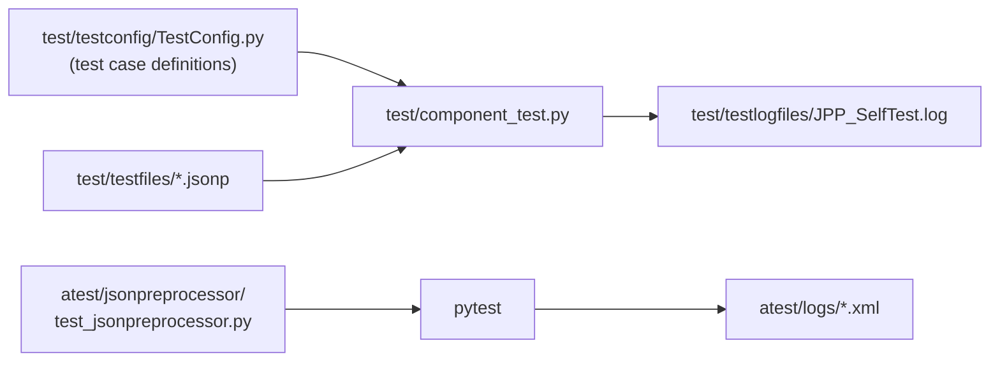

# Build, test and document

## Development setup

```bash
git clone https://github.com/test-fullautomation/python-jsonpreprocessor.git
cd python-jsonpreprocessor
python -m pip install -e ".[dev]"
```

The `dev` extra installs `pytest` and `pytest-cov`.

## Helper scripts

| Script | Purpose |
|---|---|
| `cleanup_installation.py` | removes previous installations and build artifacts |
| `genpackagedoc.py` | generates the PDF documentation from `packagedoc/` (GenPackageDoc) |
| `python -m pip install .` | installs the package from the sources |
| `python -m build .` | builds sdist and wheel |

The version is defined in `JsonPreprocessor/version.py` (`VERSION`, `VERSION_DATE`) and read by `pyproject.toml`.

## Tests



### Component test

The component test is the main regression test. Every test case (`JPP_xxxx`) is configured in
`test/testconfig/TestConfig.py` with the input file in `test/testfiles/` and the expected result (`EXPECTEDRETURN`)
or the expected exception (`EXPECTEDEXCEPTION`).

```bash
cd test
python component_test.py                         # all test cases
python component_test.py --testid="JPP_0201"     # a single test case
python component_test.py --testid="JPP_0201;JPP_0202"
```

The overview of all test cases is available in `test/JPP_TestUsecases.html` (also `.csv`, `.rst`, `.txt`).
Further options are described in `test/readme.rst`.

### Acceptance test

```bash
cd atest/jsonpreprocessor
python -m pytest test_jsonpreprocessor.py
```

On Windows also `atest/run.bat` can be used.

### Adding a test case

1. Add the JSONP input file to `test/testfiles/`.
2. Add a test case definition with a new `TESTID` to `test/testconfig/TestConfig.py`
   (`SECTION` = tested feature, `SUBSECTION` = `GOODCASE` or `BADCASE`).
3. Run the component test for the new `TESTID`, then the complete test.

## Documentation

This documentation is built with **ProperDocs** (an MkDocs fork) and the Material theme.
The configuration is `properdocs.yml`, the sources are in `doc/`.

```bash
pip install properdocs mkdocs-material pymdown-extensions
properdocs serve      # live preview on http://127.0.0.1:8000
properdocs build      # static site in build/site
```

| Need | Markdown |
|---|---|
| Diagram | ` ```mermaid ` code block |
| Hint / warning | `!!! tip`, `!!! warning`, `??? question` (collapsible) |
| Tabs | `=== "Tab title"` |
| Highlighted lines | ` ```json hl_lines="3" ` |

!!! note
    The PDF documentation (`JsonPreprocessor/JsonPreprocessor.pdf`) is still generated from `packagedoc/` with
    `genpackagedoc.py`. Content changes should be applied to both until the PDF is retired.

## Contribution checklist

1. Public API unchanged (or change documented in [API reference](../api/cjsonpreprocessor.md) and [History](../appendix/history.md)).
2. Component test and acceptance test pass.
3. New behavior covered by a test case.
4. User documentation in `doc/jsonp-format/` updated.
5. Version and date updated in `JsonPreprocessor/version.py`.
