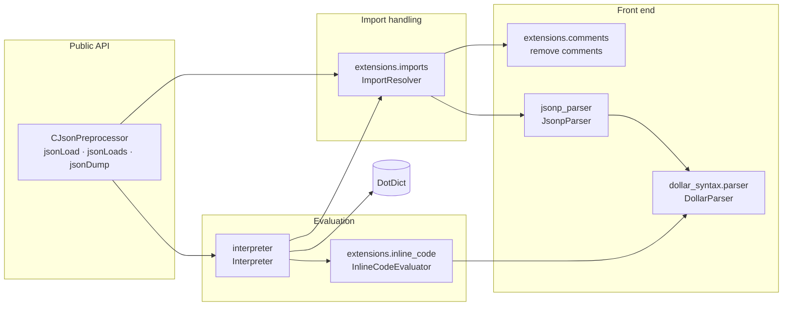
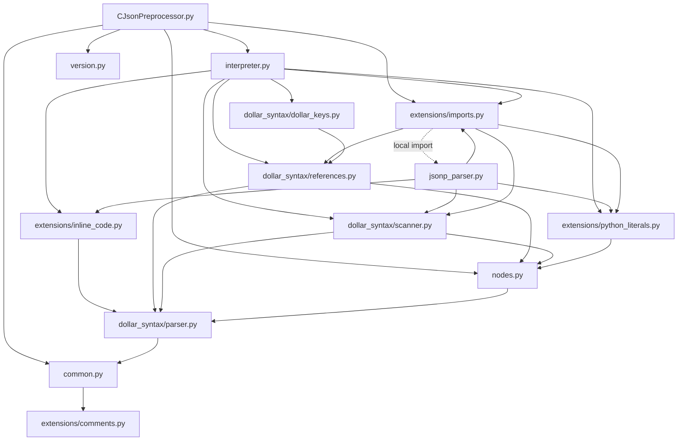

# For Developers

This chapter is meant for everybody who wants to understand, maintain or extend the JsonPreprocessor.
It gives an overview of the code base and explains how the parts work together.

## Repository layout

```text
python-jsonpreprocessor/
├── JsonPreprocessor/            # the Python package
│   ├── CJsonPreprocessor.py     # public API (facade)
│   ├── common.py                # shared helpers, error type, constants, lazy values
│   ├── nodes.py                 # AST nodes of the JSON core syntax
│   ├── jsonp_parser.py          # JSONP text -> AST (JSON core + mixins of the extensions)
│   ├── interpreter.py           # AST -> Python data (core + mixins of the extensions)
│   ├── dollar_syntax/           # everything about ${...}
│   │   ├── parser.py            #   parser of ${...} expressions
│   │   ├── scanner.py           #   ${...} in values, keys and strings (parser mixin)
│   │   ├── references.py        #   resolution of references (interpreter mixin)
│   │   └── dollar_keys.py       #   assignments with dollar keys (interpreter mixin)
│   ├── extensions/              # further JSON syntax extensions
│   │   ├── comments.py          #   // and /* */ comments
│   │   ├── python_literals.py   #   True/False/None, b'...'
│   │   ├── inline_code.py       #   <<...>> Python inline code
│   │   └── imports.py           #   "[import]" / "[import?]": loading of files, expansion
│   └── version.py               # VERSION, VERSION_DATE
├── test/                        # component test (JPP_xxxx test cases)
├── atest/                       # acceptance test (pytest)
├── sample/                      # small usage examples
├── doc/                         # this documentation (ProperDocs)
├── packagedoc/                  # sources of the PDF documentation (GenPackageDoc)
├── config/                      # repository configuration used by the helper scripts
├── properdocs.yml               # configuration of this documentation
└── pyproject.toml               # package metadata and build configuration
```

## Architecture at a glance

The JsonPreprocessor is built like a small compiler: the text is **parsed** into an abstract syntax tree (AST),
**imports** are expanded on AST level, and an **interpreter** evaluates the tree into Python data.

The core modules (`jsonp_parser`, `interpreter`) handle the plain JSON syntax only. Every syntax extension lives in its
own module - the dollar operator syntax in the package `dollar_syntax`, all other extensions in the package
`extensions` - and contributes its part to the parser and the interpreter as a **mixin class**.



## Module dependencies



There are no cyclic module level dependencies: `ImportResolver.parse` imports `jsonp_parser` locally, because the
parser itself uses the import extension. The `__init__.py` files of the subpackages intentionally import nothing.

## Design principles

| Principle | Implementation |
|---|---|
| **Separation of syntax and semantics** | Parsing (`jsonp_parser`, `dollar_syntax.parser`, scanner mixins) produces a pure data structure (AST); all semantics live in the `interpreter` and its mixins. |
| **One module per syntax extension** | Node, scanner part and evaluation part of an extension are kept together (`dollar_syntax/`, `extensions/`); the core only dispatches. |
| **JSON compatibility** | The parser follows the scanner of the Python standard library (`json.decoder`), so that JSON syntax errors keep the well known messages and positions. |
| **Imports on AST level** | An import is replaced by the members of the imported file - no text concatenation, every member keeps its origin for error messages. |
| **Order independent references** | Values are evaluated lazily, therefore a parameter can be referenced before it is defined. |
| **One error type internally** | All modules raise `JsonpError`; the facade converts it into a plain `Exception` (public contract). |
| **Stable public API** | `CJsonPreprocessor` keeps the historical camel case methods as wrappers of the snake case methods. |

## Where to go next

- [Processing pipeline](processing-pipeline.md) - the way from a file to a dictionary in detail.
- [Modules in detail](modules.md) - responsibilities and key classes of every module.
- [Build, test and document](build-and-test.md) - development environment, tests and documentation.
