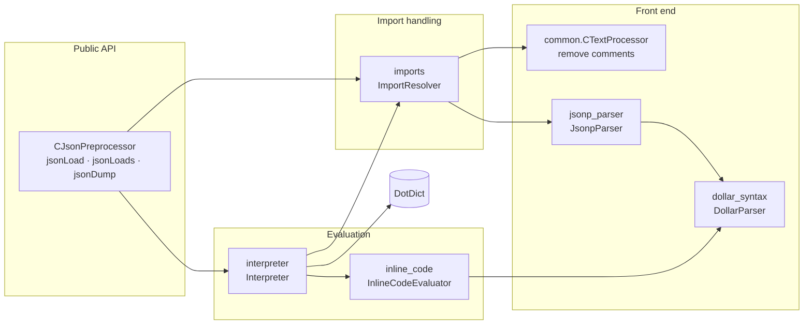
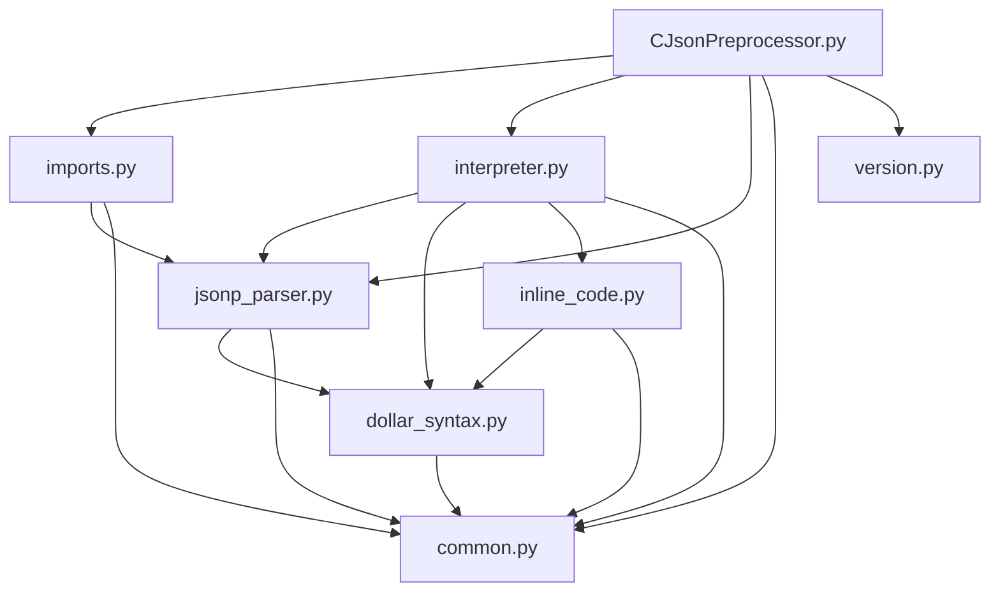

# For Developers

This chapter is meant for everybody who wants to understand, maintain or extend the JsonPreprocessor.
It gives an overview of the code base and explains how the parts work together.

## Repository layout

```text
python-jsonpreprocessor/
├── JsonPreprocessor/            # the Python package
│   ├── CJsonPreprocessor.py     # public API (facade)
│   ├── common.py                # shared helpers, error type, constants
│   ├── jsonp_parser.py          # JSONP text -> AST
│   ├── dollar_syntax.py         # parser of ${...} expressions
│   ├── imports.py               # loading of files, expansion of "[import]"
│   ├── interpreter.py           # AST -> Python data
│   ├── inline_code.py           # evaluation of <<...>> Python inline code
│   └── version.py               # VERSION, VERSION_DATE
├── test/                        # component test (JPP_xxxx test cases)
├── atest/                       # acceptance test (pytest)
├── sample/                      # small usage examples
├── doc/                         # this documentation (ProperDocs)
├── packagedoc/                  # sources of the PDF documentation (GenPackageDoc)
├── config/                      # repository configuration used by the helper scripts
├── properdocs.yml               # configuration of this documentation
└── pyproject.toml               # package metadata and build configuration
```

## Architecture at a glance

The JsonPreprocessor is built like a small compiler: the text is **parsed** into an abstract syntax tree (AST),
**imports** are expanded on AST level, and an **interpreter** evaluates the tree into Python data.



## Module dependencies



There are no cyclic dependencies: `common.py` is the base, `CJsonPreprocessor.py` is the top.

## Design principles

| Principle | Implementation |
|---|---|
| **Separation of syntax and semantics** | Parsing (`jsonp_parser`, `dollar_syntax`) produces a pure data structure (AST); all semantics live in the `interpreter`. |
| **JSON compatibility** | The parser follows the scanner of the Python standard library (`json.decoder`), so that JSON syntax errors keep the well known messages and positions. |
| **Imports on AST level** | An import is replaced by the members of the imported file - no text concatenation, every member keeps its origin for error messages. |
| **Order independent references** | Values are evaluated lazily, therefore a parameter can be referenced before it is defined. |
| **One error type internally** | All modules raise `JsonpError`; the facade converts it into a plain `Exception` (public contract). |
| **Stable public API** | `CJsonPreprocessor` keeps the historical camel case methods as wrappers of the snake case methods. |

## Where to go next

- [Processing pipeline](processing-pipeline.md) - the way from a file to a dictionary in detail.
- [Modules in detail](modules.md) - responsibilities and key classes of every module.
- [Build, test and document](build-and-test.md) - development environment, tests and documentation.
