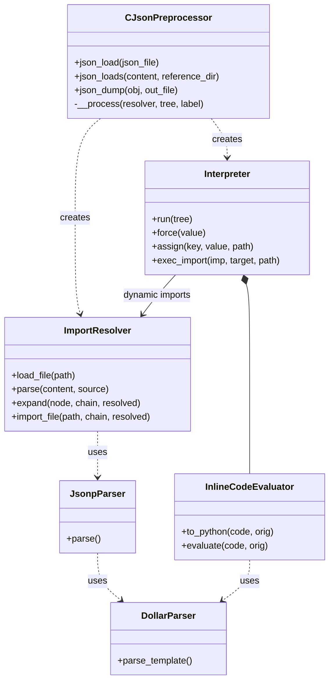

# Modules in detail

## `CJsonPreprocessor.py` - the facade

The only module users import. It validates the constructor arguments, creates an `ImportResolver` per call and drives the
[processing pipeline](processing-pipeline.md).

| Member | Responsibility |
|---|---|
| `__init__(syntax, current_cfg, key_pattern)` | validates and stores the options |
| `json_load` / `jsonLoad` | file entry point |
| `json_loads` / `jsonLoads` | string entry point, optional `reference_dir` |
| `json_dump` / `jsonDump` | writes standard JSON |
| `__process` | expansion loop for dynamic imports and final interpreter run |
| `getVersion`, `getVersionDate` | version information from `version.py` |

For backward compatibility the module also re-exports the helper classes of `common.py`
(`CSyntaxType`, `CNameMangling`, `CPythonJSONDecoder`, `CKeyChecker`, `CTreeNode`, `CTextProcessor`).

## `common.py` - shared building blocks

| Element | Purpose |
|---|---|
| `JsonpError` | internal exception type of all modules |
| `CSyntaxType` | `python` / `json` |
| `CNameMangling` | reserved internal tokens that must not occur in JSONP content |
| `CKeyChecker` | checks key names against brackets and the user defined `key_pattern` |
| `CTextProcessor` | `load_and_remove_comments` (uses `extensions.comments`), `multiple_replace`, `normalize_digits` |
| `CPythonJSONDecoder` | JSON decoder that accepts Python keywords |
| `CTreeNode` | small tree helper |
| `PY_INLINE_PATTERN`, `NUMBER_RE` | shared regular expressions |
| `Lazy`, `Busy` | lazy value placeholder and cycle detection of the interpreter |

## `nodes.py` - AST of the JSON core syntax

`Source`, `Scalar`, `Str`, `Arr`, `Member`, `Obj`. The nodes of the syntax extensions are defined in their modules
(`Bare`, `DollarKey` in `dollar_syntax/scanner.py`, `Inline` in `extensions/inline_code.py`, `Import` in
`extensions/imports.py`, `Bytes` in `extensions/python_literals.py`).

## `jsonp_parser.py` - JSONP text to AST

| Element | Purpose |
|---|---|
| `prepare_text` | line based preparation and checks (delegates the extension specific parts) |
| `JsonpParser` | recursive scanner of the JSON core syntax (modeled after `json.decoder`); combines the scanner mixins `DollarScannerMixin`, `InlineScannerMixin`, `ImportScannerMixin`, `PythonLiteralScannerMixin` |
| `parse_jsonp` | convenience function: prepare + parse |
| `format_json_error` | adds `Nearby: '...'` and `In file: '...'` to JSON syntax errors |

## `interpreter.py` - AST to Python data

| Element | Purpose |
|---|---|
| `Interpreter.run` | entry point; merges `current_cfg` into the parameter store |
| `seed_object` / `seed` | create keys in final order, literal values immediately, `Lazy` placeholders otherwise |
| `exec_object` | execute members in document order |
| `eval_node` | evaluate single nodes (dispatches to the extensions) |
| `force` | evaluate `Lazy` placeholders on demand |

`Interpreter` combines the mixins `ReferenceMixin`, `DollarKeyMixin` and `ImportExecutionMixin`.

## `dollar_syntax/` - the dollar operator syntax

### `parser.py` - the expression language

A self-contained recursive descent parser for `${...}` expressions that works on plain strings.

| Element | Purpose |
|---|---|
| `Ref` | a reference: name parts (text or nested `Ref`) + list of indices |
| `IntIndex`, `StrIndex`, `RefIndex` | `[0]`, `['key ${x}']`, `[${x}]` |
| `DollarParser` | parser; `parse_template` splits text into literal parts and references |
| `parse_template`, `has_refs` | helpers for the other modules |

### `scanner.py` - dollar operator expressions in the document

| Element | Purpose |
|---|---|
| `Bare`, `DollarKey` | AST nodes of unquoted values and keys |
| `normalize_line`, `normalize_indices` | index normalization (`[+1]` → `[1]`, `[ 'key' ]` → `['key']`, Unicode digits) |
| `DollarScannerMixin` | strings with references, unquoted values, dollar keys and their error messages |

### `references.py` - resolution of references

| Element | Purpose |
|---|---|
| `ReferenceMixin` | `eval_string`, `path_of`, `split_dotted`, `lookup`, `value_of` (incl. dotdict notation) |
| `NotAvailable` | a referenced parameter does not exist |
| `render`, `collect_dotted_keys` | rendering of parameter paths, key names containing dots |

### `dollar_keys.py` - assignments

| Element | Purpose |
|---|---|
| `DollarKeyMixin` | `assign`, `_set` (overwrite values, implicit creation of dictionaries), `_redefined_key` (key order) |

## `extensions/` - further syntax extensions

### `comments.py`

`remove_comments` removes `//` and `/* */` comments (strings are respected).

### `python_literals.py`

| Element | Purpose |
|---|---|
| `Bytes`, `evaluate_bytes` | AST node and evaluation of `b'...'` |
| `PythonLiteralScannerMixin` | scanning of `True`/`False`/`None` (syntax `python`) and byte values; byte values as key are rejected |

### `inline_code.py` - Python inline code

| Element | Purpose |
|---|---|
| `Inline` | AST node |
| `InlineScannerMixin` | scanning of `<<...>>` values and the checks for inline code at not allowed positions |
| `check_inline_in_dollar` | rejects inline code inside dollar operator expressions |
| `InlineCodeEvaluator.to_python` | translates `${...}` inside `<<...>>` into `self.jp_globals[...]` accesses |
| `InlineCodeEvaluator.evaluate` | evaluates the expression and checks the result type |
| `_Globals` | read-only mapping view on the parameter store (forces lazy values) |

!!! warning "Security"
    Inline code is evaluated with `exec`. This is by design - JSONP files must come from trusted sources.

### `imports.py` - files and imports

| Element | Purpose |
|---|---|
| `Import` | AST node (`value`, `condition`, `alternative`, `optional`) |
| `ImportScannerMixin` | import keys and import objects (`file`, `if`, `else`, `optional`) |
| `ImportResolver.load_file` | read, remove comments, parse; cached per path |
| `ImportResolver.parse` | parse content (used by `json_loads`) |
| `ImportResolver.expand` | replace imports with known paths by the imported members |
| `ImportResolver.import_file` | cyclic import detection via the import chain |
| `static_path`, `dynamic_path` | path computation relative to the importing file |
| `ImportExecutionMixin` | `exec_import`, `import_path`: imports which are resolved at evaluation time |
| `normalize_file_path` | normalization relative to the executed script |
| `has_unresolved_imports` | checks if dynamic imports remain |

## Class collaboration

