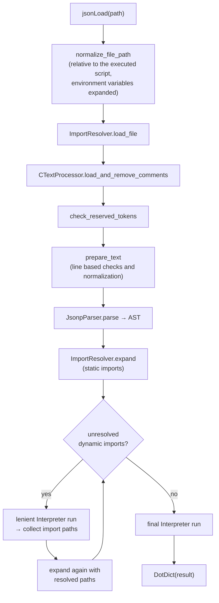
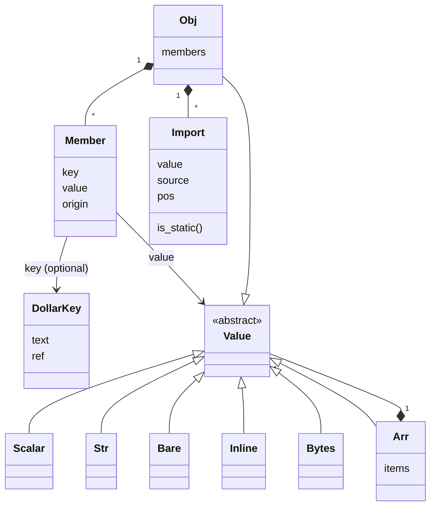
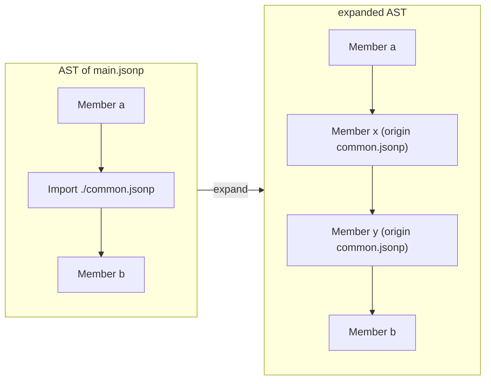
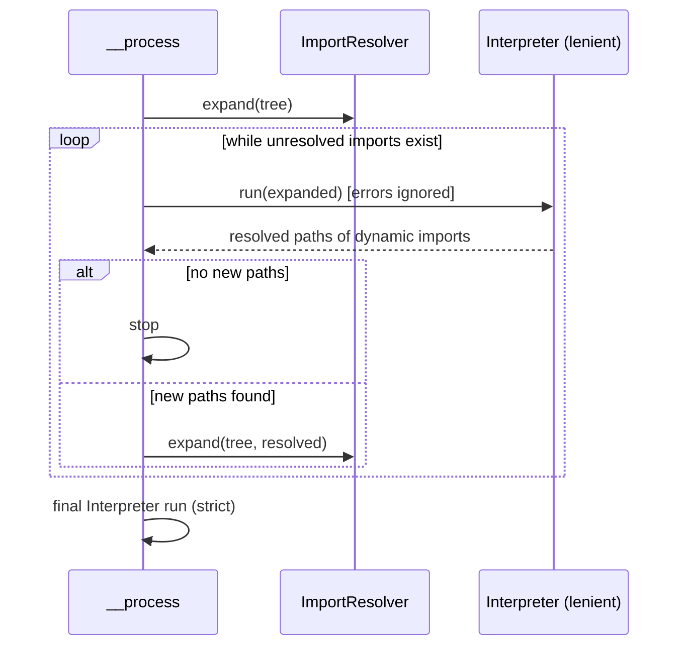
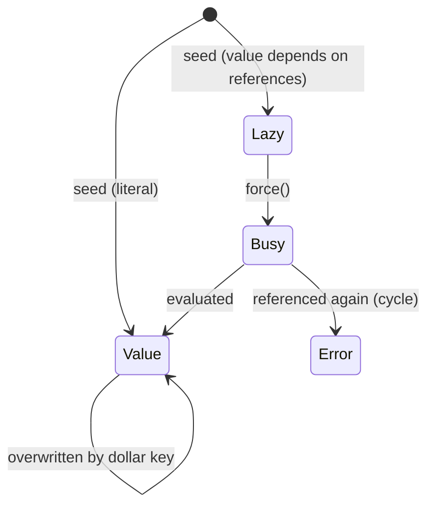

# Processing pipeline

This page follows a call of `jsonLoad("config.jsonp")` through the code.

## Overview



## 1. Loading and comment removal

`ImportResolver.load_file` reads the file and calls `CTextProcessor.load_and_remove_comments`, which removes
`//` line comments and `/* */` block comments (strings are respected). Parsed files are cached per resolver, so a file
that is imported several times is parsed only once.

`check_reserved_tokens` rejects content that contains internal marker tokens (`CNameMangling`).

## 2. Text preparation

`prepare_text` (in `jsonp_parser.py`) works line by line on the comment free text:

- removes empty lines and trailing whitespace,
- checks the quotation of every line (`shlex`),
- rejects Python inline code inside dollar operator expressions,
- normalizes index notation (`[+1]` → `[1]`, `[ 'key' ]` → `['key']`) and Unicode digits.

## 3. Parsing into an AST

`JsonpParser` is a recursive scanner modeled after `json.decoder`. In addition to standard JSON it recognizes
the JSONP extensions and produces these node types:



(`Value` is not a real class - it stands for any node that can be used as a value.)

| JSONP construct | AST node |
|---|---|
| `{ ... }` | `Obj` |
| `[ ... ]` | `Arr` |
| `1`, `true`, `None` | `Scalar` |
| `"text"` / `"text ${a}"` | `Str` (with `parts` if it contains references) |
| `${a}[0]` (unquoted value) | `Bare` |
| `<< ... >>` | `Inline` |
| `b'...'` | `Bytes` |
| `"[import]" : ...` / `"[import?]" : ...` | `Import` (`path`, `condition`, `alternative`, `optional`) |
| `${a}['k'] : ...` (key) | `Member` with `DollarKey` |

Dollar operator expressions are parsed by `DollarParser` (`dollar_syntax.py`) into `Ref` objects:

```text
template  := ( text | ref )*
ref       := '${' name '}' index*
name      := ( name_char | ref )+          -- nested references are allowed
index     := '[' ws* ( int | "'" template "'" | ref ) ws* ']'
```

Dotted names (`${a.b.0}`) are kept as plain name text in the AST - splitting them into path segments requires runtime
knowledge (a key may itself contain a dot) and is done by the interpreter.

## 4. Import expansion

`ImportResolver.expand` returns a copy of the AST in which every import with a known path is replaced by the members
of the imported file:



- **Static** paths (plain strings) are resolved immediately, relative to the importing file.
- **Dynamic** paths (containing `${...}` or `<<...>>`) stay `Import` nodes until their value is known.
- The **import chain** (list of files from the root to the current file) is used for cyclic import detection.
- Imported members get the `origin` attribute (path of the imported file) for correct key ordering and error messages.

## 5. Resolving dynamic imports

The path of a dynamic import depends on parameters - which may themselves be defined in imported files.
Therefore the facade (`CJsonPreprocessor.__process`) iterates:



The **lenient** interpreter skips imports that cannot be resolved yet and only records the paths it could compute.

## 6. Evaluation

The `Interpreter` evaluates the expanded AST. The root object is the **parameter store**: every `${...}`
is resolved against it.

1. **Seeding** (`seed_object`): every object is seeded before its members are executed. Keys are created in their
   final order (a redefined key moves to the position of its last definition). Values that do not depend on anything
   are stored immediately; all others are stored as `_Lazy` placeholders.
2. **Execution** (`exec_object`): members are executed in **document order**.
   - literal keys get their (evaluated) value,
   - dollar keys (`${...} : value`) overwrite existing values or implicitly create missing dictionaries (`assign`),
   - remaining `Import` nodes (dynamic paths) are loaded and executed in place (`exec_import`).
3. **Lazy evaluation** (`force`): a `_Lazy` placeholder is evaluated when it is referenced. This allows references to
   parameters that are defined later in the document. A placeholder that is referenced during its own evaluation
   raises `_Busy` (cyclic reference).



Python inline code (`Inline` nodes) is handed to the `InlineCodeEvaluator`: dollar operator expressions inside the code
are translated into accesses to a read-only view of the parameter store (`self.jp_globals[...]`), then the expression
is evaluated. Only results of JSON compatible types are accepted.

## 7. Result and errors

The result dictionary is wrapped into a `DotDict`. Every error inside the pipeline is a `JsonpError`
(or a subclass like `NotAvailable`); the public methods convert it into a plain `Exception` with the same message.
