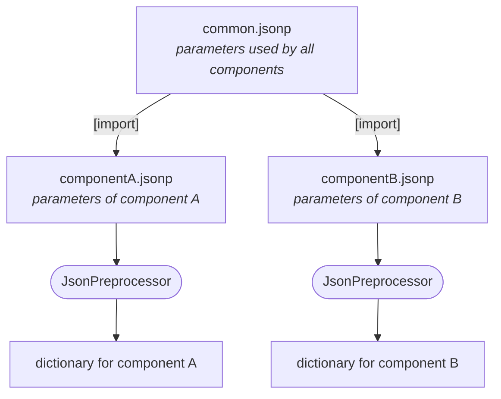

# Introduction

## Why JSONP?

JSON is a popular format for configuration files: it is simple, human readable and supported by nearly every
programming language. But for large projects with many configuration parameters, plain JSON quickly reaches its limits:

- You cannot add **comments** to explain the meaning of a parameter.
- You cannot **split** a large configuration into several files.
- You cannot **reuse** values - the same value has to be written again and again.
- You cannot **overwrite** a common value for a specific use case.

The **JsonPreprocessor** closes these gaps. It extends the JSON format by the following features:

1. Parts of a JSON file can be **commented out**.
2. A JSON file can **import** other JSON files (also nested imports).
3. **Parameters** can be defined, referenced and overwritten (follow-up definitions overwrite previous definitions of the same parameter).
4. Python keywords like `True`, `False` and `None` can be used in addition to the JSON keywords `true`, `false` and `null`.
5. **Python inline code** can be used to compute values.

## A typical use case

Imagine a software that consists of several components. Every component needs its own set of parameters, but all
components also share a common set of parameters.

With JSONP

- the common parameters are defined **only once** (in `common.jsonp`) - no redundancy, easier maintenance,
- every component file **imports** the common part and adds its own parameters,
- a component file can **overwrite** a common value if it needs a different one,
- comments explain the meaning of each parameter directly in the file.

Smaller files with a specific content are easier to maintain than a single huge file that contains everything.

## The file extension `.jsonp`

The new features cause some deviations from the JSON standard. These deviations harm the syntax highlighting of editors
and cause invalid findings of JSON related static code checkers.

To clearly separate the standard format from the extended format, the JsonPreprocessor uses the file extension
**`.jsonp`** for JSON files in extended format.

!!! tip
    For the editor **VSCodium** (and VS Code) an extension is available that adds syntax highlighting for `.jsonp` files.
    See [VSCodium support](../user-guide/vscodium-support.md).

## Where to get it

| Source | Recommended for | Link |
|---|---|---|
| PyPI | users | [JsonPreprocessor on PyPI](https://pypi.org/project/JsonPreprocessor/) |
| GitHub | developers | [python-jsonpreprocessor on GitHub](https://github.com/test-fullautomation/python-jsonpreprocessor) |

Continue with the [Installation](installation.md).
