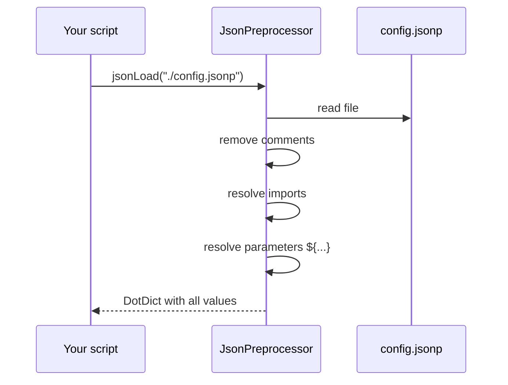

# Quick start

This page guides you through your first JSONP file in three small steps.

## Step 1 - Write a JSONP file

Create a file `config.jsonp`:

```json
{
   // general settings
   "project" : "Demo",
   "version" : 1,
   "debug"   : False,

   // a value built from other values
   "title"   : "${project} (version ${version})"
}
```

This file already uses three JSONP features: a **comment** (`//`), the **Python keyword** `False`
and **parameter references** (`${...}`).

## Step 2 - Load it with Python

Create a script `load_config.py` next to the JSONP file:

```python
from JsonPreprocessor.CJsonPreprocessor import CJsonPreprocessor
import pprint

json_preprocessor = CJsonPreprocessor()
try:
    values = json_preprocessor.jsonLoad("./config.jsonp")
    pprint.pprint(values)
except Exception as reason:
    print(f"'{reason}'")
```

The main method of the JsonPreprocessor is `jsonLoad`. Input is the path and the name of a JSONP file,
output is a dictionary containing all values parsed from this file.

!!! warning "Always use try/except"
    In case of any error in the JSONP file (syntax error, missing file, unknown parameter, ...) the JsonPreprocessor
    raises an exception. Therefore call `jsonLoad` inside a `try/except` block. See [Error handling](../user-guide/error-handling.md).

## Step 3 - Run it

```bash
python load_config.py
```

**Outcome:**

```text
DotDict({'project': 'Demo', 'version': 1, 'debug': False, 'title': 'Demo (version 1)'})
```

`pprint` is used to give the output a better readability.

## Access the values

The returned object is a **`DotDict`** - a dictionary that additionally supports attribute access:

```python
print(values['title'])   # standard dictionary access
print(values.title)      # dot notation
```

## What happens behind the scenes?



## Next steps

- Learn the complete syntax step by step in [The JSONP format](../jsonp-format/index.md).
- All discussed JSONP examples can be tested with the script from step 2.
- Keep the [Cheat sheet](../jsonp-format/cheat-sheet.md) at hand.
