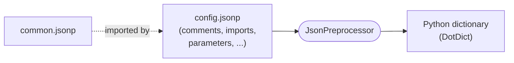

# JsonPreprocessor

**JSON with superpowers - comments, imports, parameters and more.**

The **JsonPreprocessor** is a Python package that reads JSON files written in an *extended* JSON format
(called **JSONP**) and returns a plain Python dictionary. It is made for projects that need to
maintain large and structured sets of configuration parameters.



## What you can do with JSONP

| Feature | Example | Learn more |
|---|---|---|
| Comments | `// a comment`, `/* block */` | [Comments](jsonp-format/comments.md) |
| Import other files | `"[import]" : "./common.jsonp"` | [Import of JSON files](jsonp-format/imports.md) |
| Reference parameters | `"b" : ${a}` | [Overwriting parameters](jsonp-format/overwriting-parameters.md) |
| Overwrite values | `${dict}['key'] : 42` | [Overwriting parameters](jsonp-format/overwriting-parameters.md) |
| dotdict notation | `${dict.key.sub_key}` | [dotdict notation](jsonp-format/dotdict-notation.md) |
| Python keywords | `True`, `False`, `None` | [Boolean and null values](jsonp-format/boolean-null.md) |
| Python inline code | `<<${A} + ${B}>>` | [Python inline code](jsonp-format/python-inline-code.md) |
| Byte values | `b'\x41\x42'` | [Byte sequences](jsonp-format/byte-sequences.md) |

## A first impression

```json
{
   // common values are maintained in one place only
   "[import]" : "./common.jsonp",

   "device"   : "Device_01",
   "timeout"  : 30,
   "greeting" : "Hello ${device}!",

   // overwrite a value that was defined in common.jsonp
   ${limits}['max_retries'] : 5
}
```

```python
from JsonPreprocessor.CJsonPreprocessor import CJsonPreprocessor

values = CJsonPreprocessor().jsonLoad("./config.jsonp")
print(values.greeting)          # Hello Device_01!
```

## How this documentation is organized

<div class="grid cards" markdown>

- **[Getting started](getting-started/introduction.md)** - why JSONP exists, how to install it and your first example.
- **[User guide](user-guide/python-usage.md)** - how to use the JsonPreprocessor in your Python code.
- **[The JSONP format](jsonp-format/index.md)** - the complete syntax reference, step by step, with many examples.
- **[API reference](api/cjsonpreprocessor.md)** - all public methods of `CJsonPreprocessor`.
- **[Appendix](appendix/faq.md)** - FAQ, version history and package information.
- **[For Developers](developers/index.md)** - how the code is organized and how the pieces work together.

</div>

!!! tip "Using Robot Framework?"
    The JSONP format is also the configuration format of the
    [RobotFramework_TestsuitesManagement](https://github.com/test-fullautomation/robotframework-testsuitesmanagement)
    (part of [RobotFramework AIO](https://robotframework-aio.org/)). Everything you learn here applies there as well.
