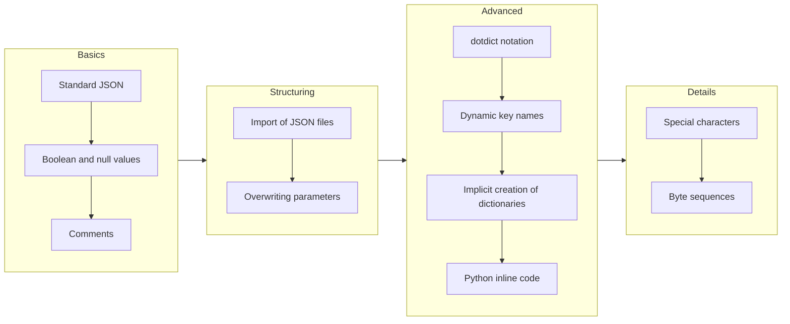

# The JSONP format - overview

This chapter explains the format of JSONP files in detail - step by step, from plain JSON to the advanced features.
We concentrate on the content of the JSONP files and the corresponding results, available as Python dictionary.

## Learning path

The sections build on each other. If you are new to JSONP, read them in this order:



| Section | You learn ... |
|---|---|
| [Standard JSON format](standard-json.md) | that every valid JSON file is also a valid JSONP file |
| [Boolean and null values](boolean-null.md) | to use `true`/`True`, `false`/`False`, `null`/`None` |
| [Comments](comments.md) | to document your configuration with `//` and `/* */` |
| [Import of JSON files](imports.md) | to split a configuration into several files |
| [Overwriting parameters](overwriting-parameters.md) | to reference and to change existing values with `${...}` |
| [dotdict notation](dotdict-notation.md) | a shorter notation to access nested values |
| [Dynamic key names](dynamic-key-names.md) | to address keys by means of parameters |
| [Implicit creation of dictionaries](implicit-creation.md) | to create nested dictionaries in one line |
| [Python inline code](python-inline-code.md) | to compute values with Python expressions `<<...>>` |
| [Special characters within key names](special-characters.md) | which characters are not allowed in key names |
| [Byte sequences](byte-sequences.md) | to embed binary values |

The [Cheat sheet](cheat-sheet.md) summarizes the complete syntax on one page.

## The basic idea: the dollar operator

Most of the JSONP features are built around one single syntax element - the **dollar operator** `${...}`.
It refers to a parameter that is defined somewhere in the JSONP file (or in an imported file).

```json
{
   "name"     : "World",
   "greeting" : "Hello ${name}!",      // right-hand side: read a value
   ${name}    : "JSONP"                // left-hand side: overwrite a value
}
```

| Position | Meaning | Example |
|---|---|---|
| Right-hand side of the colon, without quotes | value with original data type | `"b" : ${a}` |
| Right-hand side of the colon, inside quotes | value converted to string | `"b" : "prefix_${a}"` |
| Left-hand side of the colon (never in quotes) | overwrite or create a value | `${a} : 1` |

## How to read the examples

- Every example can be executed with the script from the [Quick start](../getting-started/quick-start.md).
- Some examples show only a part of a JSONP file (without the outer curly brackets).
- The **outcome** is shown in the format of Python's `pprint` for dictionaries (keys sorted alphabetically).
  The real return value is a `DotDict`, see [Standard JSON format](standard-json.md).

!!! info "JSONP in RobotFramework AIO"
    The JSONP format is also used within the test automation framework **RobotFramework AIO**
    ([homepage](https://robotframework-aio.org/)). The component that executes the JsonPreprocessor there is called
    **TestsuitesManagement**. Because Robot Framework has its own syntax rules, the JSONP format deviates in some
    cases in both worlds. Where this is the case, you find a corresponding hint.
