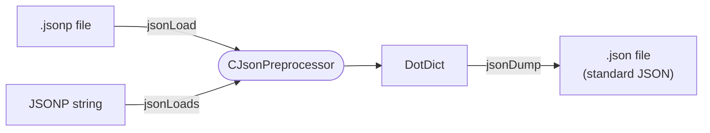

# Using the JsonPreprocessor in Python

All functionality is provided by the class `CJsonPreprocessor`.

```python
from JsonPreprocessor.CJsonPreprocessor import CJsonPreprocessor
```



## Load a JSONP file

The main method is `jsonLoad`. Input is the path and the name of a JSONP file, output is a dictionary containing
all values parsed from this file:

```python
from JsonPreprocessor.CJsonPreprocessor import CJsonPreprocessor
import pprint

json_preprocessor = CJsonPreprocessor()
try:
    values = json_preprocessor.jsonLoad("./file.jsonp")
    pprint.pprint(values)
except Exception as reason:
    print(f"'{reason}'")
```

About the path:

- It can be **absolute** or **relative**. A relative path is relative to the location of the **executed Python script**
  (not to the current working directory).
- It may contain **environment variables**, e.g. `%CONFIG_DIR%/file.jsonp` on Windows.

## Load JSONP content from a string

If the JSONP content is not available as a file (e.g. it is generated or received from somewhere), use `jsonLoads`:

```python
content = """
{
   // a comment
   "a" : 1,
   "b" : ${a}
}
"""
values = json_preprocessor.jsonLoads(content)
```

If the content contains imports with relative paths, pass the directory that shall be used as reference:

```python
values = json_preprocessor.jsonLoads('{"[import]" : "./common.jsonp"}', reference_dir="./config")
```

## Write the result as standard JSON

`jsonDump` writes a dictionary to a file in **standard** JSON format (all JSONP features resolved) and returns the normalized path:

```python
out_file = json_preprocessor.jsonDump(values, "./resolved_config.json")
```

This is useful to inspect the final result of a complex set of JSONP files or to hand it over to tools that only understand standard JSON.

## Constructor options

```python
CJsonPreprocessor(syntax=CSyntaxType.python, current_cfg={}, key_pattern=r'.+')
```

### Syntax type

| Value | Meaning |
|---|---|
| `CSyntaxType.python` (default) | Python keywords `True`, `False`, `None` are allowed in JSONP files |
| `CSyntaxType.json` | only the JSON keywords `true`, `false`, `null` are allowed |

```python
from JsonPreprocessor.CJsonPreprocessor import CJsonPreprocessor, CSyntaxType

strict = CJsonPreprocessor(syntax=CSyntaxType.json)
```

### Predefined parameters

With `current_cfg` you can pass parameters that are available in addition to the parameters of the JSONP file.
They can be referenced and overwritten in the JSONP file and are part of the result:

```python
json_preprocessor = CJsonPreprocessor(current_cfg={"target" : "Device_01"})
values = json_preprocessor.jsonLoads('{"name" : "${target}_config"}')
# {'target': 'Device_01', 'name': 'Device_01_config'}
```

### Key name pattern

With `key_pattern` you can restrict the allowed key names, see [User defined naming convention](naming-convention.md).

## Method names

All methods are available in two spellings (camel case and snake case). Both are equivalent:

| Camel case | Snake case |
|---|---|
| `jsonLoad` | `json_load` |
| `jsonLoads` | `json_loads` |
| `jsonDump` | `json_dump` |

The complete description of all methods can be found in the [API reference](../api/cjsonpreprocessor.md).
