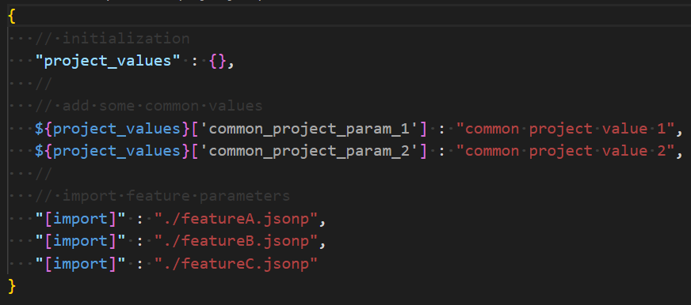
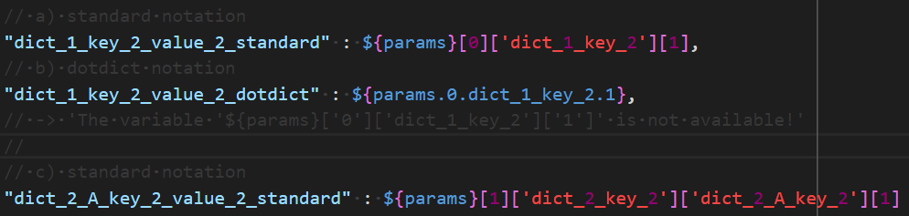

# VSCodium support

The JSON syntax extensions introduced by the JsonPreprocessor harm the syntax highlighting of editors:

- Either the JSON files get the extension `.json` - then an editor expects a JSON file in standard syntax and marks the extensions as errors,
- or the extension is changed to `.jsonp` - but then an editor usually does not know how to display a file of such type.

If you use [VSCodium](https://vscodium.com/) (or Visual Studio Code), you can install the
[jsonp extension](https://github.com/test-fullautomation/vscode-jsonp). With this extension the editor displays
`.jsonp` files properly.

## Some impressions

